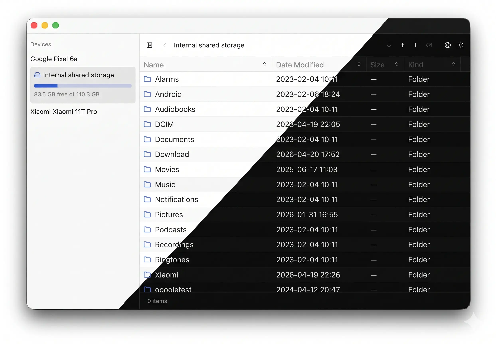

# Mulu（目录）App

[English](./README.md) | [简体中文](./README.zh-CN.md)

[](https://github.com/yangkx1024/mulu/actions/workflows/ci.yml)

基于 [gpui](https://gpui.rs) ， [gpui-component](https://gpui-kit.com) 和 [mtp-rs](https://github.com/vdavid/mtp-rs) 构建的跨平台MTP客户端。简单易用且极致轻量。



# 安装

## macOS

从 [Releases 页面](https://github.com/yangkx1024/mulu/releases/latest) 下载最新的已签名和公证的 `Mulu_*.dmg`（Apple Silicon），打开后把 `Mulu.app` 拖入 `/Applications` 即可。

## Debian / Ubuntu（apt）

已在 https://yangkx1024.github.io/mulu/ 发布 apt 软件源，`Release` 文件由独立的 GPG 密钥签名。

```sh
sudo install -d -m 0755 /etc/apt/keyrings
curl -fsSL https://yangkx1024.github.io/mulu/pubkey.asc | sudo gpg --dearmor -o /etc/apt/keyrings/mulu.gpg
echo "deb [signed-by=/etc/apt/keyrings/mulu.gpg] https://yangkx1024.github.io/mulu stable main" | sudo tee /etc/apt/sources.list.d/mulu.list
sudo apt update
sudo apt install mulu
```

后续版本发布后直接 `apt upgrade` 即可获取。

## Arch Linux（pacman）

每个 Release 都会附带 `PKGBUILD` 以及对应的 `mulu_*.tar.gz` 源码包。在 [Releases 页面](https://github.com/yangkx1024/mulu/releases/latest) 将两者下载到同一目录，然后使用 `makepkg` 构建并安装：

```sh
makepkg -si
```

## Nix / NixOS

仓库本身是一个 flake，支持 `x86_64-linux` 和 `aarch64-linux`：

```sh
# 免安装直接运行
nix run github:yangkx1024/mulu

# 安装到用户 profile
nix profile install github:yangkx1024/mulu
```

NixOS 用户可以把 `github:yangkx1024/mulu` 加为 flake input，然后安装 `inputs.mulu.packages.${pkgs.stdenv.hostPlatform.system}.default`；或者应用 `inputs.mulu.overlays.default` 后使用 `pkgs.mulu`。此构建通过 Nix 更新，因此关闭了应用内的更新检查。

Mulu 需要有权限打开手机的 USB 设备。如果识别不到手机或打开失败，请添加 libmtp 的 udev 规则，它会把访问权限授予当前登录用户：

```nix
services.udev.packages = [ pkgs.libmtp ];
```

如果 Mulu 提示设备忙，说明有其他 MTP 客户端（例如 gvfs 或 KDE 的 kio-mtp）占用了会话，请先在文件管理器中卸载手机。

## 校验 Linux 发行版

Linux 安装包（`.deb`、`.tar.gz`）同时使用 [minisign](https://jedisct1.github.io/minisign/) 对文件级签名，公钥保存在 [`minisign.pub`](./minisign.pub)。

Release 附带的 `.sig` 文件经过 base64 包装，先解码再用 [`rsign2`](https://crates.io/crates/rsign2) 校验：

```sh
base64 -d mulu_X.Y.Z_amd64.deb.sig > mulu_X.Y.Z_amd64.deb.minisig
rsign verify mulu_X.Y.Z_amd64.deb -p minisign.pub -x mulu_X.Y.Z_amd64.deb.minisig
```

# 本地编译

1. 直接`cargo run --release`运行二进制。或者
2. `cargo packager --release` （需要先安装 [`cargo-packager`](https://crates.io/crates/cargo-packager)），会在build/release目录下生成app文件。
3. 使用 Nix：`nix develop` 进入包含工具链和系统库的开发环境；`nix build` 构建软件包，产物位于 `./result`。

# License

MIT 或者 Apache-2.0.
